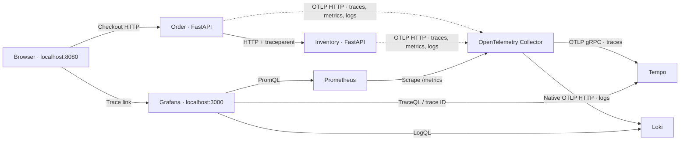

# TelemetryLab

**One checkout. Two services. Three signals that tell the same story.**

TelemetryLab is a runnable OpenTelemetry portfolio project: a FastAPI checkout calls an Inventory service over HTTP, with a small web interface to create successful requests, deterministic delays, and failures. Follow a slow request from a latency chart to its distributed trace, then into the logs that explain the delay.

Everything runs locally with Docker Compose. Products, inventory, and order IDs are synthetic. There are no payments, customer records, cloud accounts, or hosted telemetry services.

**Read next:** [Hands-on tutorial](tutorial.md) for a guided investigation, or [Design guide](design.md) for architecture, contracts, and tradeoffs.

## What you can demonstrate

- **Distributed tracing:** W3C propagation across Order → HTTPX → Inventory, plus `order.validate`, `order.check_inventory`, and `inventory.check` spans.
- **Metrics:** request throughput, error ratio, latency histograms, checkout outcomes, and inventory failures, with bounded labels.
- **Correlated logs:** application messages carry the active trace and span context through OTLP into Loki's native ingestion endpoint.
- **An investigation workflow:** Grafana dashboard → slow span → matching logs → normal checkout confirming recovery.
- **Operational care:** deadlines, fault gating, real HTTP health probes, dependency lockfile, and tests that check behavior and telemetry relationships.

## Architecture



Solid application arrows carry requests; dotted arrows carry telemetry. The Collector has separate pipelines, each starting with a memory limiter and ending with batching. All three signals leave the applications over OTLP; Prometheus scrapes the Collector's translated metrics endpoint.

## Quick start

Prerequisites: Docker Engine with Compose v2+ on Linux, or Docker Desktop in Linux-container mode on Windows/macOS. On Windows, Docker Desktop needs a working WSL2 backend. Start Docker before running the commands.

Plan for approximately **4 CPU cores, 6 GB available RAM, and 4–6 GB free disk** for images, builds, and local telemetry. These are planning estimates, not measured benchmarks. Containers have explicit memory limits totaling about 3 GB; the Docker VM and builds need additional headroom.

From this repository's root, the same command works in PowerShell, macOS, and Linux:

```text
docker compose up --build
```

Or start in the background and wait for health checks:

```text
docker compose up --build -d --wait --wait-timeout 240
docker compose ps
```

Open:

| Destination | URL |
| --- | --- |
| Checkout lab | http://localhost:8080 |
| Provisioned dashboard | http://localhost:3000/d/telemetrylab/telemetrylab |
| Order API reference | http://localhost:8080/docs |

Grafana allows anonymous **Viewer** access for this localhost demo. Administrative access is `admin` / `telemetrylab` by default. Only ports 8080 and 3000 are published, both on `127.0.0.1`; Inventory, Collector, and telemetry stores are internal. Do not expose this demo configuration on a public server.

Configuration is optional; defaults work without an `.env` file:

```powershell
# Windows PowerShell
Copy-Item .env.example .env
```

```bash
# macOS / Linux
cp .env.example .env
```

The Compose file explicitly sets `DEMO_ENABLED=true`. Application code defaults to `false` outside Compose. Set it to `false` in `.env` and recreate the services to reject fault requests in **both** services and disable the burst control. A scenario is attached to one request, never stored as global server state.

```text
docker compose up -d --force-recreate order inventory
```

Stop while retaining telemetry volumes:

```text
docker compose down
```

Delete this project's stored telemetry as well (destructive; optional reset):

```text
docker compose down --volumes
```

## A five-minute demonstration

1. **Minute 1 — baseline.** Open the checkout lab and click **Place demo order** with Healthy checkout selected. Read the HTTP 201 result, elapsed time, and trace ID. Follow **Inspect trace in Grafana**. Allow 5–15 seconds for export, batching, and scraping; refresh if needed.
2. **Minute 2 — find the delay.** Select **Slow inventory** and place another order. The default adds 1.5 seconds inside `inventory.check`, below the 3-second Inventory deadline. Open its trace and expand Order → HTTP client → Inventory. The long span identifies where the request waited.
3. **Minute 3 — reproduce an error.** Select **Inventory failure**. Inventory returns 503, Order returns 502, and no order is created. Inspect the error spans and exception event, then expand a log line in the dashboard to use its **Inspect trace** link.
4. **Minute 4 — watch aggregates.** Click **Run a traffic burst** with the desired scenario. It sends exactly 12 requests, using at most three concurrent browser workers. Watch request rates, p50/p95 latency, checkout outcomes, and Inventory failure rate in Grafana. All values come from the running services; empty panels before traffic are expected.
5. **Minute 5 — recover.** Click **Return to normal behavior**, then place an order or run a healthy burst. Confirm HTTP 201 and a normal inventory span. Quantiles and rates retain recent failures until their rolling window moves forward; process-lifetime failure counters remain nonzero by design.

The browser retains only the latest 20 activity rows in memory. Reloading clears the list. Its elapsed result is server-side checkout time, not a fabricated benchmark or a browser-to-server round-trip measurement.

## Incident investigation: “Checkout suddenly feels slow”

1. Establish a baseline with a healthy burst. Run a slow burst next. In Grafana, select both services and the last 15 minutes.
2. See the Inventory latency chart and checkout p95 rise. A latency histogram tells you the distribution changed, but cannot alone explain why.
3. Open one of the slow requests from the checkout activity table. The trace's HTTPX client span is the parent of Inventory's server span; the shared trace ID proves these are the same request across process boundaries.
4. Select `inventory.check`. Its duration includes the injected sleep. The surrounding Order span waits on Inventory; Order validation does not contain the delay.
5. Use **Logs for this span**, or open Loki Explore and run:

   ```logql
   {service_namespace="telemetrylab"} | trace_id = "PASTE_THE_ACTUAL_TRACE_ID"
   ```

   Look for `Injecting slow inventory response` and its `demo_delay_seconds` metadata. The span-specific link filters by service and trace; the query above retrieves both services. Trace IDs are structured metadata, not indexed stream labels.
6. Return to normal behavior and submit another order. Inspect its new trace and `Order completed` log. Generate more healthy traffic to see the latency window recover. A quiet period produces no new latency observations.

To exercise the deadline rather than a successful slow request, temporarily set `DEMO_SLOW_SECONDS=4` while leaving `INVENTORY_TIMEOUT_SECONDS=3`, recreate both app services, and select Slow inventory. Checkout returns HTTP 504. Restore the defaults afterward. Inventory work can finish after the client stops waiting; a timeout does not imply cancellation propagated to the remote service.

## OpenTelemetry is not a database

| Component | Responsibility here |
| --- | --- |
| OpenTelemetry API/SDK + instrumentors | Create spans, record measurements, attach log context, propagate trace context, export OTLP |
| OpenTelemetry Collector | Receive and process signals; enforce a memory budget; batch and export |
| Tempo | Store and query traces |
| Prometheus | Scrape, store, and query time-series metrics |
| Loki | Store and query logs and their structured metadata |
| Grafana | Visualize and link the three backends |

Instrumentation is explicit: FastAPI is instrumented once per app and the Order HTTPX client once per instance. Do not also run `opentelemetry-instrument` around these services. Instrumentor-generated HTTP metrics are dropped by an SDK view in favor of one deliberately named, route-scoped request metric set. Health checks, static files, and configuration requests do not inflate business request metrics.

The SDK attaches consistent service names (`order-service`, `inventory-service`), namespace, version, and deployment environment. The demo uses `ALWAYS_ON`, including for remote unsampled parents, so each request is inspectable. Production usually needs a parent-aware sampling strategy and a volume budget; tail sampling can retain slow/error traces but needs memory, latency, and consistent trace routing. Metrics remain aggregate measurements rather than sampled trace counts.

See [the telemetry reference](docs/telemetry.md) for exact metric names, labels, queries, and correlation configuration.

## Testing and development

The full dependency graph, including transitive packages and hashes, is committed in `uv.lock`. Containers use Python 3.13.9, uv 0.9.13, and explicit backend versions. Version tags are pinned; they are not immutable digest pins. Review and rerun the smoke suite before upgrades.

Install [uv](https://docs.astral.sh/uv/getting-started/installation/) and use Python 3.13 for host-side checks, or let uv obtain it:

```text
uv sync --frozen --python 3.13
uv run ruff check .
uv run ruff format --check .
uv run pytest -q
node --test tests/ui.test.cjs
docker compose config --quiet
```

With the stack running, execute the **live smoke test** inside Order (same command on every OS; no host Python needed):

```text
docker compose exec -T order python scripts/smoke.py --order-url http://order:8080 --grafana-url http://grafana:3000
```

Alternatively, `python scripts/smoke.py` uses the default localhost URLs and only the standard library. Override `--order-url` and `--grafana-url` if you change host ports.

Application tests check propagation, cross-service span parentage, logs with active trace/span IDs, bounded metric labels, disabled faults, invalid requests, deadlines, dependency errors, and recovery. Browser-logic tests use Node.js 22+ with DOM/API fixtures to verify the 12-request/concurrency-three bound, double-click protection, reset, and disabled demo controls; they do not replace a real browser visual check. The live smoke test checks persisted distributed traces and exception status in Tempo, both services' correlated logs in Loki, metric increments in Prometheus, provisioned dashboard expressions, and recovery. GitHub Actions runs lint/tests and a separate Compose end-to-end job; failed runs upload container logs.

Regenerate the dashboard after changing its readable query source:

```text
python scripts/build_dashboard.py
```

## Design decisions and limitations

- **No durable order storage.** An order is a synthetic confirmation response and an associated telemetry event. Inventory is a fixed catalog; stock is checked but never reserved or decremented. There is no transaction, idempotency, payment, or order lookup. Restarting apps resets counters and restarting the browser clears activity.
- **Per-request faults.** There is no global “break Inventory” switch. A slow request does not make an unrelated normal request slow. The UI reset selects normal for subsequent requests; it does not rewrite old traces or cancel remote work.
- **Bounded demo traffic.** The UI burst has exactly 12 requests and concurrency three. Controls lock until completion. This is a demonstration boundary, not server-side authentication, rate limiting, or load testing.
- **Deadlines, no retries.** Inventory has a connect timeout of at most one second and a three-second total Order deadline by default. Automatic retries could multiply load and create duplicate operations without idempotency.
- **Local telemetry storage.** Named volumes persist backend data. Retention is approximately 24 hours, with a 512 MB Prometheus size cap. Loki/Tempo cleanup is asynchronous and neither has a hard disk quota here; monitor disk use and reset demo volumes when needed.
- **No HA or delivery guarantee.** One instance per component, in-memory SDK/Collector queues, local filesystems, no TLS internally, no application authentication. Collector overload or abrupt shutdown can lose telemetry. Health endpoints establish process readiness, not end-to-end data delivery; the smoke test covers that path.
- **Histogram estimates.** Explicit buckets cover fast requests through multi-second delays. p50/p95 are estimates; the trace gives an individual request's actual duration. Rates need at least two scrapes and recent traffic.
- **Original code versus dependencies.** Project code is MIT; Docker images and packages retain their respective upstream licenses.

Reasonable next steps: durable order persistence with idempotency; inventory reservations; integration contract tests; authenticated control endpoints and server admission limits; SLOs and alerts; load tests with realistic arrival patterns; TLS/auth; persistent Collector queues; and trace sampling validated against a telemetry cost budget.

## Troubleshooting

| Symptom | What to check |
| --- | --- |
| Docker cannot connect | Start Docker Desktop/Engine; use Linux containers. On Windows check `wsl --list --verbose`. |
| A container is unhealthy | `docker compose ps -a`, then `docker compose logs --tail=100 SERVICE`. Each health check makes an actual HTTP request. |
| Bind error on 8080 or 3000 | Change `ORDER_PORT` / `GRAFANA_PORT` in `.env`. Also change `GRAFANA_PUBLIC_URL` so trace links use the new Grafana port. |
| Trace not found immediately | Wait 5–15 seconds, retry the same link, and check `docker compose logs otel-collector`. Ensure Tempo listens on `0.0.0.0:4317` internally. |
| No metrics | Send checkouts, wait for SDK export plus two 5-second scrapes, then refresh. Query `lab_requests_total` through Grafana Explore. |
| No logs or broken trace links | Check the Collector logs pipeline, Loki v13/TSDB schema and structured metadata, `service_name` labels, and `trace_id` metadata. Use the native `/otlp/v1/logs` endpoint. |
| Slow request becomes 504 | `DEMO_SLOW_SECONDS` must be below `INVENTORY_TIMEOUT_SECONDS` for the successful slow scenario. |
| Faults return 403 | Explicitly enable `DEMO_ENABLED=true` on both app services, then recreate them. |
| Password change doesn't work | Grafana initializes its admin password on first volume creation. Change it in Grafana, or intentionally reset that volume. |
| Package downloads fail behind corporate TLS inspection | Follow the optional [build-secret certificate setup](docs/corporate-tls.md). Host uv can use the system trust store. Keep certificate verification enabled. |

## Repository map

```text
services/
  common/                # Settings, synthetic catalog, SDK setup, metrics middleware
  order/                 # Checkout API + static browser interface
  inventory/             # Inventory API + deterministic faults
infra/
  otel-collector.yaml    # Separate traces / metrics / logs pipelines
  tempo.yaml             # Local trace storage
  loki.yaml              # Native OTLP logs, TSDB v13, retention
  prometheus.yaml        # Collector scrape job
  grafana/               # Provisioned data sources and dashboard
  Dockerfile.probe       # Static HTTP health probe for backend images
scripts/
  smoke.py               # Live cross-signal and dashboard verification
  build_dashboard.py     # Readable dashboard query source
tests/                   # Application and telemetry contract checks
docs/                    # Signal reference, captures, validation record
.github/workflows/       # Lint, tests, and Compose smoke CI
compose.yaml             # Complete local stack
tutorial.md              # Guided observability exercises and checkpoints
design.md                # Architecture, contracts, decisions, and tradeoffs
pyproject.toml / uv.lock # Pinned application + development dependencies
```

See [validation results](docs/validation.md) and [screenshot instructions](docs/screenshots.md). Captures and results must come from a real run; missing captures are identified there.

## Official integration references

Configuration was checked against the official documentation while implementing this project:

- [OpenTelemetry Python instrumentation](https://opentelemetry.io/docs/languages/python/instrumentation/) and [FastAPI instrumentation](https://opentelemetry-python-contrib.readthedocs.io/en/latest/instrumentation/fastapi/fastapi.html) for SDK setup and explicit app instrumentation.
- [Loki native OTLP ingestion](https://grafana.com/docs/loki/latest/send-data/otel/) for the HTTP exporter, structured metadata, and normalized attribute names.
- [Tempo Collector integration](https://grafana.com/docs/tempo/latest/set-up-for-tracing/instrument-send/set-up-collector/otel-collector/) for OTLP and explicit container receiver binding.
- [Collector v0.140.0 Prometheus exporter](https://github.com/open-telemetry/opentelemetry-collector-contrib/blob/v0.140.0/exporter/prometheusexporter/README.md) for the pinned version's name translation and label behavior.
- [Grafana trace/log correlation](https://grafana.com/docs/grafana/latest/datasources/tempo/configure-tempo-data-source/configure-trace-to-logs/) for bidirectional linking and custom metadata filters.

**Suggested GitHub description:** A hands-on OpenTelemetry checkout lab with FastAPI, distributed traces, correlated logs, metrics, and provisioned Grafana dashboards—all running locally with Docker Compose.

## License

[MIT](LICENSE) for original TelemetryLab code.
