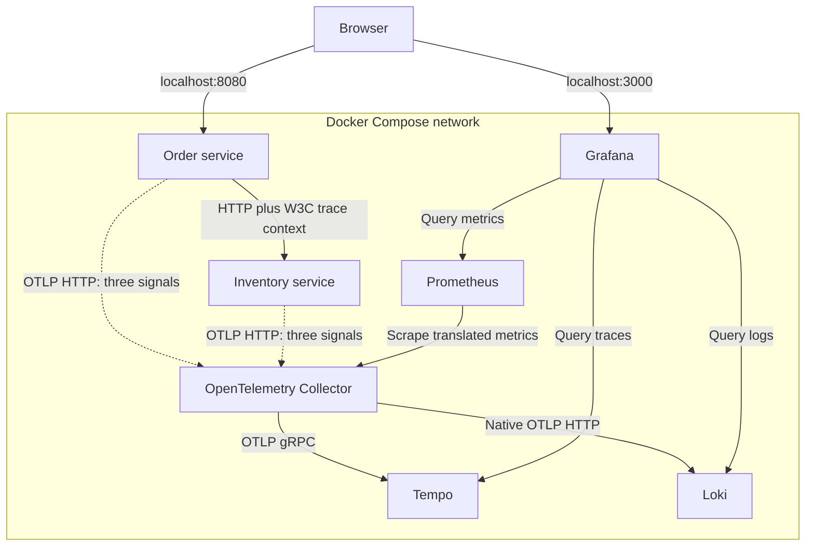
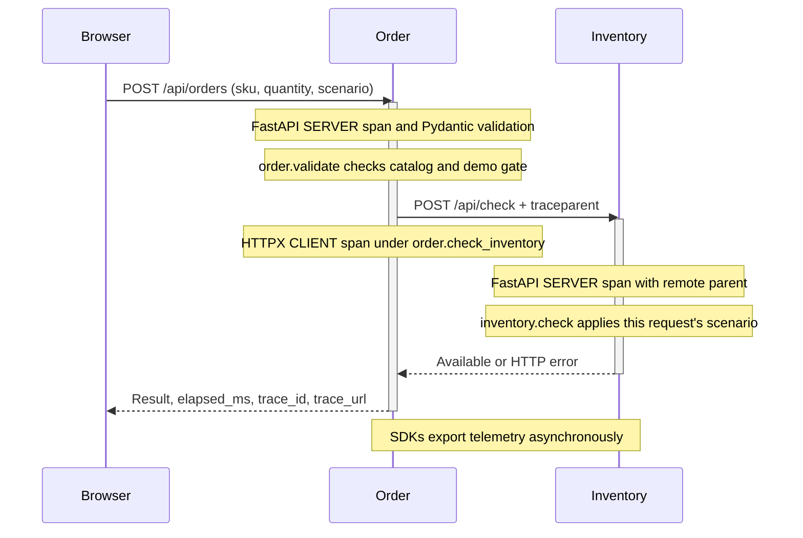

# TelemetryLab design

TelemetryLab makes the relationships between requests, distributed traces, aggregate metrics, and application logs inspectable in a small local system. A checkout calls one HTTP dependency. Deterministic request-scoped faults create a controlled incident, and the three telemetry signals provide complementary evidence.

The implemented system is a teaching and portfolio application. It does not implement a production checkout, payment flow, or durable order ledger. [tutorial.md](tutorial.md) walks through the system from an investigator's perspective.

## Goals and boundaries

| Goal | Implemented choice |
| --- | --- |
| Show a real distributed request | Two FastAPI services communicate over HTTP using HTTPX |
| Demonstrate all three signals | Python SDKs send traces, metrics, and logs through an OTel Collector |
| Make faults reproducible | Explicit `normal`, `slow`, and `failure` request scenarios |
| Make investigation convenient | Trace IDs in responses, Grafana links, provisioned datasources/dashboard |
| Keep local operation accessible | Docker Compose, no paid backend, no cloud account |
| Keep results defensible | Tests check propagation and actual backend ingestion; no invented captures |

Non-goals include payments, personal data collection, database transactions, inventory reservations, idempotency, high availability, sustained load testing, authentication, and production SLO enforcement.

## Components and boundaries



The application request path is independent of the telemetry export path. Normal request handlers do not synchronously wait for Tempo, Prometheus, or Loki. SDK batching and periodic metric export add a delay between a response and its visibility in Grafana; they also introduce buffering and possible loss on abrupt shutdown.

| Component | Internal endpoint | Host exposure |
| --- | --- | --- |
| Order | `order:8080` | `127.0.0.1:8080` by default |
| Inventory | `inventory:8081` | None |
| Collector OTLP HTTP | `otel-collector:4318` | None |
| Collector Prometheus exporter | `otel-collector:8889` | None |
| Collector health extension | `otel-collector:13133` | None |
| Tempo query / OTLP | `tempo:3200` / `tempo:4317` | None |
| Loki | `loki:3100` | None |
| Prometheus | `prometheus:9090` | None |
| Grafana | `grafana:3000` | `127.0.0.1:3000` by default |

Internal receivers explicitly bind to container-accessible interfaces. Publishing only the two user-facing ports reduces accidental exposure; it does not turn this configuration into an authenticated deployment.

## Checkout lifecycle



Order owns the checkout response. It validates the catalog entry, checks the demo setting, and calls Inventory using a lifespan-managed asynchronous client. It creates a synthetic order ID only after a valid, available response. Prices use integer cents to avoid floating-point currency calculations.

Inventory owns the availability decision and fault behavior. Its catalog is fixed; a check does not decrement or reserve stock. Normal requests can therefore repeat indefinitely without exhausting the demo.

### API contract

| Service / endpoint | Behavior |
| --- | --- |
| Order `GET /` | Serves the interface and references same-origin static assets |
| Order `GET /api/products` | Returns the synthetic catalog |
| Order `GET /api/config` | Returns demo availability, slow delay, burst bounds, and public dashboard URL |
| Order `POST /api/orders` | Runs checkout and returns its result and trace reference |
| Inventory `POST /api/check` | Checks availability and applies the requested demo scenario |
| Both `GET /healthz` | Reports local application health |

The checkout request accepts a SKU of 1-32 characters, a strict integer quantity from 1 to 10, and one of the three scenario values. Unknown fields are rejected. Omitted fields default to `LAB-MUG`, quantity `1`, and `normal`.

| Order result | HTTP status | Cause |
| --- | --- | --- |
| Confirmed | 201 | Valid checkout and available inventory |
| Fault rejected | 403 | A non-normal scenario while Order demo mode is disabled |
| Stock unavailable | 409 | Inventory explicitly reports `available=false` |
| Invalid request | 422 | Schema or catalog validation fails |
| Dependency failure | 502 | Inventory HTTP/connection error or malformed successful response |
| Deadline exceeded | 504 | Inventory call exceeds a timeout or total deadline |

The default catalog has more stock than the maximum permitted quantity, so the 409 branch is a contract for an unavailable upstream response rather than a built-in user-selectable demo. Inventory itself returns 503 for its injected failure and 403 when its own demo gate rejects a fault.

Handled checkout responses include the active trace ID; the business-route middleware also returns `X-Trace-ID`. The response's elapsed value measures server handler time. The request histogram measures middleware duration across the request, including validation and response handling, so the two values are not required to be identical.

## Fault isolation and time bounds

`DEMO_ENABLED` defaults to false in Python. Compose explicitly opts into demo mode with a true default. Both APIs enforce the setting; the browser uses it to disable unsupported controls.

A scenario travels in a single request body. There is no shared fault-mode variable to reset and no persistent outage state. The UI's reset button selects `normal` for future requests. Concurrent normal and slow requests can coexist without the slow request changing the behavior of its neighbor.

Default timing:

- Slow Inventory adds **1.5 seconds** using asynchronous sleep in `inventory.check`.
- HTTPX has a connect timeout of at most **one second** and other operation timeouts based on the configured Inventory timeout.
- `asyncio.timeout` enforces a **three-second total dependency deadline**, including connection-pool waiting and response decoding.
- The browser has a **20-second fetch deadline**, allowing room above the configurable server deadline.

There are no automatic retries. Retries would obscure the demonstration and need an idempotency strategy before applying them to a real checkout. A timeout cancels the local operation but does not guarantee cancellation of Inventory work already received over HTTP.

The burst sends exactly **12 requests**, with **three browser workers**, then stops. Controls remain locked until those workers finish. This is a UI traffic bound, not a server admission policy: separate clients can still create more load.

## Instrumentation ownership

[`services/common/telemetry.py`](services/common/telemetry.py) creates explicit providers for traces, metrics, and logs. Each app receives its own `Telemetry` instance. Provider ownership follows the application lifespan; tests can inject in-memory exporters and metric readers without a Collector.

FastAPI is instrumented once per app. Order instruments its specific HTTPX client once. There is no additional command-line auto-instrumentation wrapper, and HTTPX is not patched globally. FastAPI helper send/receive spans are excluded to keep the trace understandable.

Resources are consistent across the signals:

| Attribute | Value |
| --- | --- |
| `service.name` | `order-service` or `inventory-service` |
| `service.namespace` | `telemetrylab` |
| `service.version` | `1.0.0` by default |
| `deployment.environment.name` | `local` by default |

Resource construction is explicit rather than automatically promoting machine identifiers into telemetry dimensions.

### Traces and propagation

The propagator combines W3C trace context and W3C baggage. HTTPX injects the active context into the downstream request; Inventory extracts it when creating its server span. Baggage support does not automatically turn arbitrary baggage values into metric labels.

Custom spans distinguish work inside the service from transport time:

- `order.validate`: catalog and demo-gate checks after request schema validation.
- `order.check_inventory`: the dependency operation, including its deadline.
- `inventory.check`: availability checks and injected delay/failure.

Raised failures generate exception events on the enclosing custom spans. Handled dependency failures also mark the current Order server span and produce correlated error logs. HTTP instrumentors mark server/client error responses according to their conventions.

`ALWAYS_ON` sampling makes every local demo request inspectable, including requests with an unsampled remote parent. In production, a parent-aware policy and a telemetry volume budget would usually be needed. Tail sampling is another option for retaining slow/error traces, but adds buffering, latency, and trace-routing requirements. No sampling decision replaces aggregate request metrics.

### Metrics and cardinality

The project deliberately owns its business-route HTTP metrics. An SDK view drops instrumentor-generated `http.*` instruments so the dashboard does not rely on overlapping instrumentor request measurements. Health checks, static assets, and configuration requests do not contribute to the business metrics.

| Instrument | Prometheus name | Meaning / bounded dimensions |
| --- | --- | --- |
| `lab.requests` | `lab_requests_total` | Request count by fixed route and HTTP status |
| `lab.request.errors` | `lab_request_errors_total` | Responses >=400 by fixed route and status |
| `lab.request.duration`, unit `s` | `lab_request_duration_seconds_bucket`, `_sum`, `_count` | Request duration by fixed route and status |
| `lab.orders` | `lab_orders_total` | POST checkout results by `outcome=success` or `failure` |
| `lab.inventory.failures` | `lab_inventory_failures_total` | Injected Inventory outages by `reason=simulated` |

The Collector adds only `service_name` and `environment` from resources as application-wide metric dimensions. Exporter bookkeeping labels can also appear. Order IDs, trace IDs, span IDs, SKU, full URLs, and exception messages are not metric labels.

Known status counters and finite outcome counters are initialized with zero. This gives rate calculations a baseline for the first event after scraping begins. Histograms receive only actual request durations; the code never inserts fake zero-duration observations.

Explicit histogram boundaries in seconds are:

```text
0.005, 0.01, 0.025, 0.05, 0.1, 0.25, 0.5, 1, 1.5, 2, 3, 5, 10
```

Prometheus adds the `+Inf` bucket. The boundaries cover fast requests and multi-second faults, but quantiles are bucket estimates. A service restart resets cumulative counters; `rate()` handles counter resets, while the dashboard's labeled process-lifetime totals visibly restart.

### Logs and correlation

A Python `LoggingHandler` connects application logging to the OTel `LoggerProvider`. It captures the active trace/span context and exports log records over OTLP. A separate console handler provides JSON for Docker logs; no stdout scraper ingests that stream a second time.

Loki indexes service name, namespace, and environment. Trace/span IDs and other detailed attributes remain structured metadata. Attribute names with dots are normalized by Loki, which is why Grafana queries `service_name` and `trace_id`.

The Tempo datasource's trace-to-logs query filters structured metadata rather than searching for an ID inside the human-readable message. Loki's label-based derived field links `trace_id` back to Tempo. Provisioning escapes Grafana template variables with double dollars so they survive environment substitution.

## Collector and storage configuration

| Pipeline | Processing order | Destination |
| --- | --- | --- |
| Traces | `memory_limiter`, `batch` | Tempo over OTLP gRPC |
| Metrics | `memory_limiter`, `transform/metric_labels`, `batch` | Prometheus-format exporter, scraped by Prometheus |
| Logs | `memory_limiter`, `batch` | Loki native OTLP HTTP |

The Collector listens for application OTLP HTTP on port 4318. Its memory limiter checks every second, with a 256 MiB limit and 64 MiB spike allowance. Batching has a one-second timeout, a target batch size of 512, and a maximum size of 1024. These are demo settings, not a production capacity model.

Loki receives `/otlp/v1/logs`: its exporter endpoint is configured as `http://loki:3100/otlp`, and the exporter appends `/v1/logs`. Loki uses a TSDB v13 schema with structured metadata enabled. The deprecated Collector Loki exporter is not used.

The Prometheus exporter explicitly uses `UnderscoreEscapingWithSuffixes`, making metric-name translation part of the dashboard contract. Prometheus scrapes every five seconds. SDK metrics export every two seconds; SDK trace/log batching schedules every 500 ms before Collector batching. These intervals explain why signals can arrive at different times.

Tempo and Loki use local storage with approximately 24-hour retention. Prometheus has 24-hour retention and a 512 MB size cap. Cleanup is asynchronous, and Loki/Tempo have no hard disk quota in this lab. Named Docker volumes survive `docker compose down` and are removed by an intentional `docker compose down --volumes`.

## Grafana design

The provisioned datasource UIDs are stable: `prometheus`, `tempo`, and `loki`. The dashboard UID is `telemetrylab`. The browser builds public Grafana URLs separately from internal Docker service URLs, so changing the host Grafana port requires updating `GRAFANA_PUBLIC_URL`.

The dashboard provides request rates, error ratio, p50/p95 latency, process-lifetime checkout counts, checkout outcome rates, Inventory performance, and a log panel. Quantile queries aggregate histogram buckets by `le`; service comparisons also retain `service_name`. The error ratio uses a fraction from zero to one, formatted on a 0-100% axis.

[`scripts/build_dashboard.py`](scripts/build_dashboard.py) is the readable query source. The generated JSON is committed for automatic provisioning. Tests check that the JSON matches its generator, and the live smoke test submits the actual provisioned expressions to Prometheus through Grafana.

## Deployment and configuration

Both apps run as a non-root user in a pinned Python container. Python dependencies and hashes are locked in `uv.lock`. Monitoring image tags and build-tool versions are explicit. Tags can be retagged upstream, so they do not provide the immutability of digest pins.

Backend images may lack a shell or HTTP utility. [`infra/Dockerfile.probe`](infra/Dockerfile.probe) adds a small statically compiled HTTP probe instead of assuming `curl` or `wget` exists. The Python services use the standard library for health checks. Health proves local readiness, while the smoke test proves end-to-end signal delivery.

| Setting | Default | Where it matters |
| --- | --- | --- |
| `DEMO_ENABLED` | Python: false; Compose: true | Both API fault gates and browser controls |
| `DEMO_SLOW_SECONDS` | 1.5 | Inventory's per-request sleep |
| `INVENTORY_TIMEOUT_SECONDS` | 3.0 | Order's dependency timeout/deadline |
| `ORDER_PORT` | 8080 | Compose host publication |
| `GRAFANA_PORT` | 3000 | Compose host publication |
| `GRAFANA_PUBLIC_URL` | `http://localhost:3000` | Browser dashboard/trace links |
| `GRAFANA_ADMIN_PASSWORD` | `telemetrylab` | Initial local Grafana admin setup |

The app also supports explicit service version, environment, Inventory URL, OTLP endpoint, and telemetry-enabled settings in [`config.py`](services/common/config.py). Compose wires internal addresses and resource values directly; arbitrary `.env` entries are not automatically forwarded into containers. Configuration changes require service recreation rather than only a browser refresh.

Corporate CA handling is opt-in through a BuildKit secret. The local override and public certificate bundle are ignored by Git. Certificates are neither baked into the image nor published with the repository. See [corporate-tls.md](docs/corporate-tls.md).

## Verification strategy

| Layer | Evidence |
| --- | --- |
| Application contracts | Validation, fault gating, dependency error handling, deadline cancellation, recovery |
| In-memory telemetry | Shared trace IDs, exact client/server parentage, active log span IDs, bounded metric attributes |
| Browser logic | Fixed burst count/concurrency, double-click protection, reset, disabled demo behavior |
| Configuration contracts | Collector pipeline structure, native Loki endpoint, localhost bindings, dashboard generation |
| Live smoke | Queryable Tempo traces, Loki correlation, Prometheus increments/error ratio, provisioned dashboard queries |
| CI | Separate application and full Compose jobs; diagnostics retained on failures |

In-process ASGI tests need care: Python context variables must not bypass the HTTP boundary. The propagation test clears local context in its test transport so only the injected headers carry parentage into Inventory, as they would between real processes. The live smoke test independently checks the actual two-container path.

The browser tests use DOM/API fixtures and do not establish rendering correctness. The [validation record](docs/validation.md) distinguishes completed tests, visual inspection, and missing screenshots. CI configuration alone is not evidence of a hosted passing run.

## Decisions and consequences

| Decision | Benefit | Cost or limitation |
| --- | --- | --- |
| Two services and one dependency | Easy-to-follow distributed trace | Does not model a large service graph |
| Fixed catalog and response-only order confirmation | Repeatable demos with minimal setup | No reservation, persistence, or transaction guarantees |
| Request-scoped faults | Deterministic and isolated experiments | Does not reproduce all infrastructure outage behavior |
| Explicit instrumentation | Clear ownership and no duplicate wrappers | Instrumentation setup must be maintained |
| Custom route-scoped metrics | Stable queries and bounded dimensions | Smaller metric surface than generic auto-instrumentation |
| Full trace sampling | Every local request can be inspected | Unsuitable as an unexamined high-volume production policy |
| Local single-instance backends | Free, understandable deployment | No HA, distributed durability, or operational isolation |
| Anonymous Grafana Viewer on localhost | Frictionless demonstration | Must be redesigned before public deployment |

Production evolution would require durable orders with idempotency, inventory reservations, authentication, admission limits, encrypted service connections, telemetry redaction rules, persistent export queues, capacity planning, and tested sampling. Alerts and SLOs should be defined from actual user journeys and traffic, not copied from the synthetic demo's delays.

For exact signal queries and the official integration references used during implementation, see [the telemetry reference](docs/telemetry.md) and [README sources](README.md#official-integration-references).
