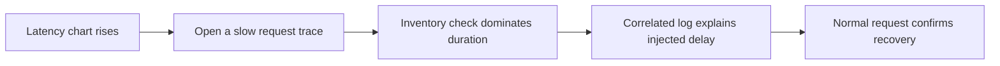

# TelemetryLab tutorial

Learn to connect a checkout symptom to the service, span, and log entry that explain it.

This walkthrough takes approximately 25-35 minutes. You will run the existing application, generate real telemetry, reproduce a slow dependency and a failure, and verify recovery. There are no payments or customer records. The timing estimates below describe the exercise, not application benchmarks.

For an overview, start with [README.md](README.md). For implementation decisions, read [design.md](design.md).

## 1. Start the lab

You need Git and Docker with Compose v2 or newer. On Windows/macOS, start Docker Desktop with Linux containers enabled; Windows also needs its WSL2 backend. Allow roughly 4 CPU cores, 6 GB available RAM, and 4-6 GB free disk for Docker and builds.

The following commands work in Windows PowerShell, macOS, and Linux:

```text
git clone https://github.com/AshokRana25/TelemetryLab.git
cd TelemetryLab
docker compose up --build -d --wait --wait-timeout 240
docker compose ps
```

If you already have the project locally, run the last two commands from its root instead of cloning it again. The first build downloads the pinned images and Python dependencies, so it may take several minutes.

**Checkpoint:** all seven services should be healthy: `order`, `inventory`, `otel-collector`, `tempo`, `prometheus`, `loki`, and `grafana`.

Open these URLs:

| Page | URL | Purpose |
| --- | --- | --- |
| Checkout lab | http://localhost:8080 | Generate requests and open their traces |
| Dashboard | http://localhost:3000/d/telemetrylab/telemetrylab | Compare request rates, errors, latency, and logs |
| API reference | http://localhost:8080/docs | Inspect the API schema and send requests |

Grafana permits anonymous Viewer access. The local administrator credentials are `admin` / `telemetrylab` unless you changed them. Backend query and ingestion ports are internal to Docker.

If a service is unhealthy:

```text
docker compose logs --tail=100 order inventory otel-collector
```

For a corporate certificate error during the build, use the [optional trusted-CA setup](docs/corporate-tls.md). It keeps TLS verification enabled.

## 2. Follow one successful request

In the checkout interface, leave **Healthy checkout** selected and click **Place demo order**. Observe the response rather than comparing it to an invented sample:

- HTTP status should be **201**.
- The result contains an order ID, elapsed server time, and a 32-character trace ID.
- **Inspect trace in Grafana** opens that request using the provisioned Tempo datasource.

Allow 5-15 seconds for telemetry export and storage. If the trace is not immediately available, refresh the same trace link.

Expand the trace until you can identify this structure:

```text
POST /api/orders                         Order server span
  order.validate                        Catalog and demo-setting checks
  order.check_inventory                 Order's dependency operation
    HTTP client span                    HTTPX request to Inventory
      POST /api/check                    Inventory server span
        inventory.check                 Inventory work
```

The HTTP client span's display name may vary with semantic conventions. Its kind is CLIENT; Inventory's incoming span is SERVER. They have different span IDs but share the same trace ID. Inventory's server span is a child of Order's HTTP client span.

**What this teaches:** a trace ID joins the request across services, while the parent span ID describes the causal relationship. The Order service's HTTPX instrumentor injects W3C context into the outgoing request, and Inventory's FastAPI instrumentor extracts it.

**Checkpoint:** find both `order-service` and `inventory-service` in one trace. Do not add nested span durations together: a parent duration includes time spent waiting for its children.

## 3. Find the matching logs

Select an Inventory span in the trace and use **Logs for this span**. The configured link filters Loki by service and trace ID, with a small time allowance around the span.

To inspect logs from both services, open Grafana **Explore**, select **Loki**, and switch to the query code editor if needed. Paste the real trace ID from your checkout into this query:

```logql
{service_namespace="telemetrylab"} | trace_id = "PASTE_YOUR_TRACE_ID_HERE"
```

For a successful request, look for these application messages:

```text
Order validated
Inventory checked
Order completed
```

Expand a log entry to inspect `trace_id`, `span_id`, and `service_name`. The log's internal **Inspect trace** link returns to Tempo.

These identifiers come from the active OpenTelemetry span when the Python logger emits the message. They are not obtained by parsing the checkout response. Loki stores trace and span IDs as structured metadata, so the query filters them after the stream selector instead of putting them inside `{...}`.

**Checkpoint:** find logs from both services for the same actual trace ID, and recognize that different log messages can belong to different spans in that trace.

## 4. Turn individual requests into metrics

Select **Healthy checkout** and click **Run a traffic burst**. The browser sends exactly 12 requests with a maximum of three in flight. It locks the controls until the burst finishes.

Open the provisioned dashboard. Select **All** services and a recent time range such as the last 15 minutes. Wait for at least two 5-second Prometheus scrapes. The dashboard should show checkout outcomes, request rates, latency, and application logs.

In Grafana Explore, select **Prometheus** and try these queries:

```promql
# Cumulative successful orders since the current Order process started
sum(lab_orders_total{service_name="order-service",outcome="success"})
```

```promql
# Requests per second, averaged over a rolling minute
sum by (service_name) (rate(lab_requests_total[1m]))
```

```promql
# Inventory p95 server latency in seconds
histogram_quantile(0.95,
  sum by (le) (
    rate(lab_request_duration_seconds_bucket{service_name="inventory-service"}[1m])
  )
)
```

The exported names differ from the SDK's dotted instrument names because the Collector applies Prometheus name translation. For example, `lab.request.duration` with unit `s` becomes `lab_request_duration_seconds_bucket`, `_sum`, and `_count`.

**What this teaches:** counters answer how many events occurred, `rate()` describes their recent frequency, and histogram buckets estimate a latency distribution. A p95 value is not the duration of a particular request. Use its trace for that.

**Checkpoint:** explain why Order and Inventory usually show similar request counts for valid checkouts, but can diverge when Order rejects input before contacting Inventory.

## 5. Investigate a slow checkout

1. Select **Slow inventory** and place an order.
2. Check that checkout still succeeds with HTTP 201. With default settings, Inventory adds a 1.5-second delay inside a three-second Order deadline.
3. Open the request's trace. Find `inventory.check` and compare its duration with `order.validate`.
4. Inspect the correlated logs. Locate `Injecting slow inventory response`; its metadata records `demo_delay_seconds`.
5. Run a slow burst and watch the Inventory and checkout latency charts.

This is the investigation chain:



**Checkpoint:** identify the dependency that consumed the time, then explain why Order's enclosing span is also slow even though its validation span is fast.

The delay applies only to requests carrying `scenario="slow"`. It does not mutate a global Inventory mode. A healthy request from another browser session can run while a slow request is waiting.

## 6. Investigate a failed checkout

Select **Inventory failure** and place another order. With demo mode enabled, the outcome is deterministic:

| Observation | Expected behavior |
| --- | --- |
| Inventory HTTP response | 503 |
| Order HTTP response | 502 |
| Order confirmation | No order ID is returned |
| Inventory custom span | ERROR status and an exception event |
| Correlated logs | Inventory failure and Order rejection messages |
| Metrics | Failed order, request error, and inventory failure counters increase |

Run a failure burst and inspect the error-ratio and checkout-outcome panels. Known status counters are initialized to zero so the first error can contribute to a rate after baseline scrapes.

```promql
# Order error ratio: a fraction from 0 to 1 when requests are flowing
sum(rate(lab_request_errors_total{service_name="order-service"}[1m]))
/
clamp_min(sum(rate(lab_requests_total{service_name="order-service"}[1m])), 0.000001)
```

The dashboard displays the ratio as a percentage. Its numerator counts HTTP responses >=400, including validation errors; it is broader than just server failures.

**Checkpoint:** distinguish the upstream 503 from the downstream 502. Both belong to the same causal chain, but describe different HTTP exchanges.

## 7. Verify recovery

Click **Return to normal behavior**, then place an order and run a healthy burst.

Verify HTTP 201, a new successful trace, and an `Order completed` log. Normal selection affects subsequent requests; it does not erase old failures or change stored telemetry.

The rolling error rate and latency charts may retain the previous incident until the window moves forward. The failed-order total stays nonzero because it counts failures since the Order process started. These are expected properties of the measurements, not evidence that reset failed.

## 8. Optional: send a checkout from the command line

PowerShell:

```powershell
$body = @{ sku = 'LAB-MUG'; quantity = 1; scenario = 'normal' } | ConvertTo-Json
$order = Invoke-RestMethod -Uri 'http://localhost:8080/api/orders' -Method Post -ContentType 'application/json' -Body $body
$order | Format-List
```

macOS/Linux:

```bash
curl --fail-with-body -sS http://localhost:8080/api/orders \
  -H 'Content-Type: application/json' \
  -d '{"sku":"LAB-MUG","quantity":1,"scenario":"normal"}'
```

Use `slow` or `failure` to select those scenarios. PowerShell reports non-2xx responses as errors, and `curl --fail-with-body` returns a nonzero exit code for the failure scenario while showing its response body. These are expected client behaviors.

You can also send an invalid quantity such as `0` through the API reference. Order returns 422 without contacting Inventory. A trace and error measurement remain useful even when no downstream call occurred.

## 9. Optional: distinguish a deadline from an upstream failure

Create `.env` only if you do not already have one; preserve existing settings:

```powershell
# PowerShell
if (-not (Test-Path .env)) { Copy-Item .env.example .env }
```

```bash
# macOS/Linux
test -f .env || cp .env.example .env
```

Edit these values in `.env`:

```dotenv
DEMO_ENABLED=true
DEMO_SLOW_SECONDS=4
INVENTORY_TIMEOUT_SECONDS=3
```

Recreate the app services:

```text
docker compose up -d --force-recreate order inventory
```

Select **Slow inventory**. Order should return **504** because its deadline expires before Inventory finishes. The dependency did not deliberately return 503 in this scenario. Inspect the trace and `Inventory request timed out` log to see the distinction.

Inventory may finish its work after Order stops waiting. Cancelling a local HTTP operation does not guarantee remote cancellation.

Restore `DEMO_SLOW_SECONDS=1.5` and recreate the two app services before continuing. The smoke test expects the default slow scenario to succeed.

## 10. Optional: disable fault injection

Set `DEMO_ENABLED=false` in `.env`, then recreate Order and Inventory as above and refresh the page. Slow/failure controls and the burst button are disabled. A direct request with `scenario="slow"` or `scenario="failure"` is rejected by either service with HTTP 403 when it reaches that service's demo gate.

A normal checkout still works. Restore `DEMO_ENABLED=true` and recreate both services before the smoke test. Enabling faults only in the browser would be insufficient: the APIs must enforce the setting too.

## 11. Run the automated investigation

With the default demo settings restored, run this command on any supported operating system:

```text
docker compose exec -T order python scripts/smoke.py --order-url http://order:8080 --grafana-url http://grafana:3000
```

It generates healthy, slow, failure, and recovery traffic, then polls the real backends for:

- A common trace ID and correct cross-service span parentage.
- A slow Inventory span and exception status for the failure trace.
- Logs from both services with trace/span metadata.
- Updated success, failure, error-ratio, and duration measurements.
- Finite results for every provisioned PromQL dashboard target.

The script prints `PASS` for checks that actually succeed and exits nonzero if a required condition does not arrive. A healthy container alone is not proof that telemetry is reaching storage.

For code-level checks, install uv, Python 3.13, and Node.js 22+:

```text
uv sync --frozen --python 3.13
uv run ruff check .
uv run ruff format --check .
uv run pytest -q
node --test tests/ui.test.cjs
```

See [the validation record](docs/validation.md) for what has actually been run and [screenshot instructions](docs/screenshots.md) for authentic portfolio captures. No screenshot or performance result is fabricated.

## 12. Stop and explain what you learned

Stop the stack while preserving its telemetry volumes:

```text
docker compose down
```

For an intentional full telemetry reset, `docker compose down --volumes` also deletes this project's named volumes. Application order confirmations are not stored in a database; browser activity disappears on reload.

Practice answering these questions using your own observed requests:

1. Which signal first revealed the problem, and which explained its cause?
2. How did trace context cross the HTTP boundary?
3. Why is a trace ID useful in log metadata but unsuitable as a metric label?
4. Why can checkout be slow without being an error?
5. Why do rates and cumulative totals behave differently after recovery?
6. What would change when moving from this local demo to production?

Use [design.md](design.md) to connect those answers to the code and its deliberate limitations.
